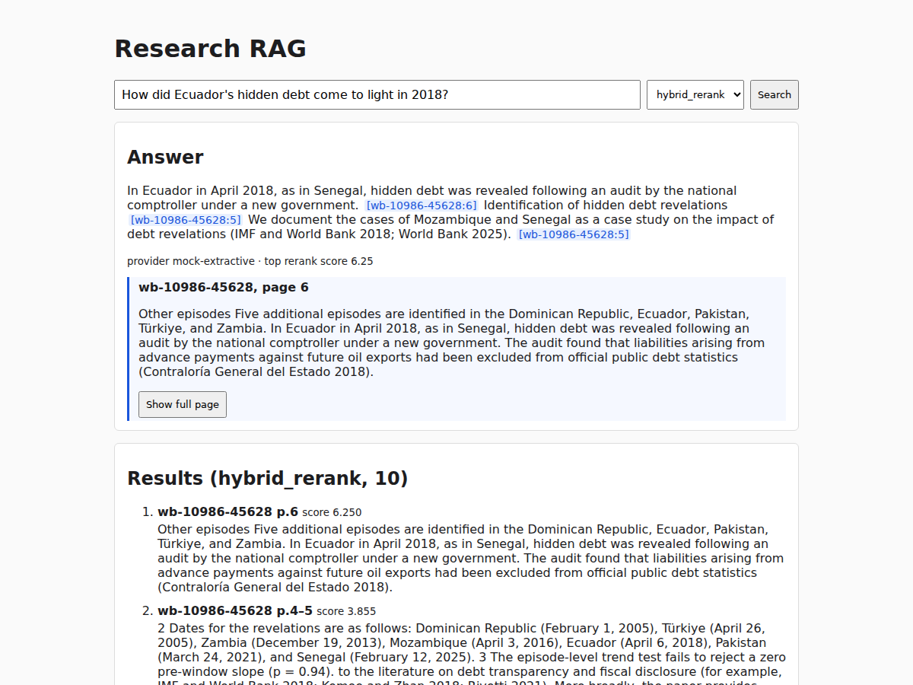

# research-rag-platform

A research knowledge platform for economics and finance papers. It ingests openly licensed
World Bank working papers and arXiv q-fin preprints into PostgreSQL + pgvector, runs hybrid
search (BM25 + dense vectors + a cross-encoder reranker), and answers questions with page-level
citations that are checked before they reach the user. The same service is exposed three ways:
a FastAPI backend, a React + TypeScript UI, and an MCP server that any MCP client can call.

**Start here: [docs/GUIDE.md](docs/GUIDE.md)** (how the whole project works, file by file).

The core of the project is the **evaluation**: a 58-question gold set with verbatim quotes, and
a measured ablation of chunking strategies, embedding models and search modes.

## Why it's hard

- **Retrieval quality is the bottleneck.** Finance papers are full of numbers, names and
  jargon. A general-purpose embedding model alone found the gold passage in the top 10 only
  64.7 % of the time on this corpus. Getting to 85 % took BM25, fusion and a reranker.
- **Comparing chunkers fairly.** Different chunkers produce different chunk ids, so gold labels
  are stored as (document, page, verbatim quote) and matched by character overlap. This lets
  one eval set score every strategy.
- **Citations must be true.** Every `[doc_id:page]` the generator emits is checked against
  the passages it was actually shown. Invalid citations are stripped, unsupported sentences are
  flagged, and if nothing valid survives the system abstains.
- **Knowing when not to answer.** Abstention is gated on the reranker score *before*
  generation, so questions the corpus can't answer never reach the LLM.
- **Honest selection.** Picking the "best config" on the same eval set inflates scores, so
  selection is also cross-validated.

## Demo



*The web UI at `http://localhost:8080` (headless Chromium capture). The answer comes from the
extractive mock; each `[doc_id:page]` is a button, and clicking one shows the cited passage.*

```bash
make db corpus ingest          # Postgres, download the 22 PDFs (sha256-checked), ingest
docker compose up -d --build --wait
# open http://localhost:8080 and ask:
#   "How did Ecuador's hidden debt come to light in 2018?"   -> cited answer, click a citation
#   "Who won the 1998 football World Cup?"                   -> abstains
```

API docs are at `http://localhost:8000/docs`. Routes: `GET /health`, `GET /search`,
`POST /ask`, `GET /documents/{doc_id}`.
MCP tools: `search`, `get_document`, `summarise`, `compare_reports` (`make mcp` for stdio, or
`python -m rag.mcp_server --http PORT` for Streamable HTTP).

## See it working

Assumes the collections are already ingested (`make db corpus ingest`, once).

1. **Start the stack:** `make up`. You should see `api-1 Healthy` and `web-1 Healthy` in the
   output (the first build takes a few minutes).
2. **Open the web UI:** go to `http://localhost:8080`, type
   `How did Ecuador's hidden debt come to light in 2018?` and press Search. You should see an
   answer citing `[wb-10986-45628:6]`, and below it the 10 ranked passages. Click the citation:
   the passage from page 6 appears (as in the screenshot above).
3. **Check abstention:** ask `Who won the 1998 football World Cup?`. You should see
   `Not found in corpus.` and a top rerank score far below the -1.31 threshold (about -8.8).
4. **Open the API docs:** go to `http://localhost:8000/docs`. You should see the Swagger page
   with `/health`, `/search`, `/ask` and `/documents/{doc_id}`; `curl localhost:8000/health`
   prints `{"status":"ok",...,"provider":"mock-extractive"}`.
5. **Stop it:** `make down`.

## Quick start

Requirements: Docker, Python 3.12, Node 20 (for the web build). Large data lives outside the
repo under `~/rag-data` (venv, PDFs, Hugging Face cache).

```bash
# host venv with CPU-only torch
python -m venv ~/rag-data/venv
~/rag-data/venv/bin/pip install torch --index-url https://download.pytorch.org/whl/cpu
~/rag-data/venv/bin/pip install -e ".[dev]"

make reproduce     # db -> fetch corpus -> ingest 3 chunkers + bge-small -> all evals -> results/
make test          # pytest (Testcontainers pgvector, fake models, no PDFs needed)
make up            # db + api (:8000) + web (:8080)
```

Or fully in containers:

```bash
docker compose --profile ingest run --rm ingest   # fetch PDFs + build all collections
docker compose up -d --build --wait
docker compose --profile eval run --rm eval       # regenerate results/
```

Generation uses a deterministic extractive mock by default. Set `ANTHROPIC_API_KEY` to switch
to the Claude provider (see the limitations below: it has never been run).

## Corpus

22 documents, 582 pages (10 to 43 pages each), listed in `corpus/manifest.json`:
10 World Bank Open Knowledge Repository working papers (CC BY 3.0 IGO) and 12 arXiv q-fin
preprints (CC BY 4.0). Licences were verified by script, and the evidence URL is stored for
each document. **The PDFs are not committed.** `scripts/fetch_corpus.py` downloads them and
fails on any sha256 mismatch.

## Key results

All numbers come from `results/`. 51 answerable + 7 unanswerable questions
(`eval/questions.jsonl`, method in `eval/METHOD.md`). One question is about 0.02 recall, so
gaps under about 0.04 are noise.

Retrieval, recursive chunker, all-MiniLM-L6-v2 (`results/retrieval_recursive.md`):

| mode | R@1 | R@5 | R@10 | MRR@10 | ms/query (CPU) |
|---|---|---|---|---|---|
| dense | 0.275 | 0.588 | 0.647 | 0.405 | 13.7 |
| bm25 | 0.490 | 0.716 | 0.833 | 0.596 | 1.5 |
| hybrid (RRF) | 0.333 | 0.627 | 0.745 | 0.478 | 16.7 |
| hybrid_rerank | 0.480 | 0.716 | 0.853 | 0.606 | 1291.7 |

Ablation highlights (`results/ablation_retrieval.md`, 28 configs):

| finding | number |
|---|---|
| Best config: fixed-size chunks + hybrid_rerank (MiniLM) | R@5 0.794, R@10 0.853, MRR@10 0.672 |
| 5-fold cross-validated selection (same config in all 5 folds) | held-out MRR@10 0.672 |
| bge-small-en-v1.5 vs MiniLM, dense only | MRR@10 0.405 -> 0.500 |
| bge-small vs MiniLM, plain RRF hybrid | MRR@10 0.478 -> 0.582 |
| All recursive variants after reranking | MRR@10 0.606-0.612 |

Answers, end to end (`results/answer_quality.md`, mock provider):

| metric | result |
|---|---|
| Faithfulness (sentences supported by a cited passage) | 139/139 = 1.000 (control: 0.079) |
| Citations pointing at a gold page | 37/128 = 0.289 |
| Answers citing at least one gold page | 37/51 = 0.725 |
| Abstention, in-sample at threshold -1.31 | precision 1.000, recall 1.000 |
| Abstention, leave-one-out | precision 0.857, recall 0.857 |

### Read these numbers honestly

- **Generation is a mock.** Every answer comes from the extractive mock, which copies
  sentences verbatim. The Anthropic provider is implemented but has never run (no API key).
  Faithfulness 1.000 only shows that the citation plumbing works (right passage, right page).
  It says nothing about an LLM's tendency to hallucinate.
- **Citation accuracy is low by design: 37/128.** The mock cites up to 3 passages, and usually
  only one of them holds the gold quote.
- **Abstention rests on n = 7 unanswerable questions.** The threshold was fitted on the same
  58 questions. Leave-one-out thresholds ranged from -2.29 to -0.34, so the threshold is unstable.
- **The deployed config is not the CV-best one.** It runs recursive + hybrid_rerank (MRR 0.606),
  not fixed (0.672). The abstention threshold was calibrated on recursive's reranker scores,
  and the gap is about 3 questions out of 51. Switching to fixed means setting
  `RAG_STRATEGY=fixed` and re-running calibration and the answer eval.

## Deployment status

- `docker compose` (db + api + web, all with healthchecks) has been run locally and reached
  healthy.
- Terraform for one Oracle Cloud Always Free Ampere VM is in `infra/terraform/`. It passes
  `make tf-check` (fmt, init, validate). **It has never been applied**: no cloud account was
  used.
- CI (`.github/workflows/ci.yml`) has three jobs: Python lint + tests, web build + vitest, and
  Terraform checks. **It has not run on GitHub** (no remote yet). The same commands were run
  locally.

## Target roles

- **DBS, Accenture**: production RAG with evaluation, FastAPI, Postgres/pgvector, Docker,
  Terraform, CI.
- **MAS**: an economics/finance research database with licence-checked sources, citations and
  abstention.
- **HTX xCyber** (secondary): grounded answers, citation validation and refusal gating as
  safeguards for an LLM system.

## Docs

- `docs/GUIDE.md`: study guide (start here): stack, code map, request trace, every feature
- `docs/FEATURES.md`: tech stack, workflow and a short explainer for each feature
- `docs/DESIGN.md`: decisions, trade-offs, baseline vs improved, limitations
- `docs/INTERVIEW_NOTES.md`: likely questions and the hardest parts explained
- `DECISIONS.md`: the full decision log
