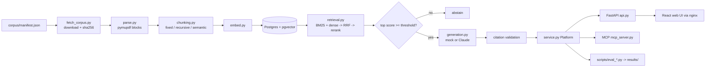

# Features

## Tech stack

| Tool | Used for |
|---|---|
| Python 3.12 | Ingest, retrieval, generation, API, MCP server, eval scripts (`rag/`, `scripts/`) |
| pymupdf | PDF parsing in "blocks" (paragraph) mode |
| sentence-transformers | Embeddings (all-MiniLM-L6-v2, bge-small-en-v1.5) and the cross-encoder reranker (ms-marco-MiniLM-L-6-v2) |
| PyTorch (CPU-only) | Runs the models; no GPU needed |
| rank_bm25 | In-memory Okapi BM25 keyword search |
| PostgreSQL 16 + pgvector | Documents, chunks and 384-d vectors, with partial HNSW indexes |
| psycopg + psycopg_pool | Database access through a connection pool |
| FastAPI + pydantic | HTTP API (`/health`, `/search`, `/ask`, `/documents/{doc_id}`) |
| mcp (Python SDK) | MCP server with tools `search`, `get_document`, `summarise`, `compare_reports` |
| Anthropic SDK | Optional Claude provider (implemented, never run: no API key) |
| React 18 + TypeScript + Vite 5 | Web UI: search, cited answers, passage viewer |
| nginx | Serves the UI and proxies `/api` to the API |
| Docker Compose | db + api + web, plus `ingest` and `eval` job profiles |
| Terraform (OCI provider) | One Oracle Cloud Always Free VM (validated, never applied) |
| GitHub Actions | CI: ruff, pytest, web build + vitest, terraform validate (not yet run on GitHub) |
| pytest + Testcontainers, vitest | Integration tests on a real pgvector container; web component test |

## End-to-end workflow

`scripts/fetch_corpus.py` downloads the 22 licensed PDFs listed in `corpus/manifest.json` and
checks each sha256. `rag.ingest` parses them, chunks them with three strategies, embeds the
chunks and stores them in pgvector. At query time the retriever runs BM25 and vector search,
fuses the two lists with RRF and reranks the top 50 with a cross-encoder. `/ask` abstains if the
top reranker score is below the threshold. Otherwise it sends the passages above the threshold
to the provider (the extractive mock by default), then validates every citation before
returning. The FastAPI app and the MCP server both call the same `Platform` facade. The eval
scripts call it too and write `results/`.

## Licence-checked corpus download

The corpus is 10 World Bank working papers (CC BY 3.0 IGO) and 12 arXiv q-fin preprints
(CC BY 4.0), 582 pages in total. Each manifest entry records the licence, a URL with evidence
for it, the pinned arXiv version and a sha256. The PDFs are not in git.
`scripts/fetch_corpus.py` downloads them to `$RAG_PDF_DIR` and fails if any hash does not
match. Files: `corpus/manifest.json`, `scripts/fetch_corpus.py`.

## PDF parsing and cleaning

pymupdf's "blocks" mode returns layout paragraphs in reading order. The parser normalises the
text with NFKC (which folds ligatures such as "fi"), removes soft hyphens and line-end
hyphenation, and drops bare page-number blocks. Pages are joined into one canonical document
text, and a chunk is stored as character offsets into that text, so any chunk or sentence can
be mapped back to a page. File: `rag/parse.py`.

## Three chunking strategies

All three strategies target 1000-character chunks, which fit the embedding model's 256-token
window. Fixed-size chunks overlap by 150 characters. Recursive chunks split at the coarsest separator
that fits (blank line, line break, sentence end, then clause and word breaks). Semantic chunks embed each sentence with its neighbours and
break where the cosine distance passes the document's 90th percentile. Chunks are keyed by
(strategy, embedding model), so several collections share one table. Files: `rag/chunking.py`,
`rag/ingest.py`, `migrations/001_init.sql`.

## Hybrid search with reranking

There are four modes: `dense` (pgvector HNSW), `bm25` (rank_bm25 in memory, k1 = 1.5,
b = 0.75), `hybrid` (Reciprocal Rank Fusion with k = 60 over the top 50 of each list,
optionally weighted) and `hybrid_rerank` (the cross-encoder re-scores the top 50 hybrid
candidates). Each (strategy, model) pair has its own partial HNSW index, so a filtered query
still returns k rows. Files: `rag/retrieval.py`, `rag/embed.py`, `rag/db.py`.

## Cited answers with abstention

`/ask` always uses `hybrid_rerank`. If the top cross-encoder score is below
`RAG_ABSTAIN_THRESHOLD` (default -1.31, from `scripts/calibrate_abstain.py`), it abstains
without calling the provider. Otherwise the provider writes an answer with `[doc_id:page]`
citations. The default provider is a deterministic extractive mock. It takes the sentence that
best covers the question terms from each top passage and cites the page that sentence starts on.
`AnthropicProvider` is used when `ANTHROPIC_API_KEY` is set, but it has never been run. Files:
`rag/generation.py`, `rag/service.py`.

## Citation validation

A citation counts as valid only if a passage shown to the provider comes from that document
and spans that page. Invalid citations are removed from the text and listed in
`invalid_citations`. Sentences left with no valid citation are kept but listed in
`unsupported_sentences`. If no valid citation survives, the system abstains. Files:
`rag/generation.py`, `rag/service.py`, `rag/schemas.py`.

## Summarise and compare reports

`summarise` picks sentences Luhn-style: it scores them by how common their terms are in the
document, keeps the top n in document order and cites each one. `compare_reports` takes a
query and two documents. For each document it runs BM25 over that document's chunks to get 20
candidates, then reranks them with the same cross-encoder used by `/ask`. Files:
`rag/service.py`, `rag/mcp_server.py`.

## FastAPI backend

The API has four routes: `GET /health` (returns 503 `degraded` if the database fails, and
`degraded` if the collection is empty), `GET /search?q=&mode=&k=`, `POST /ask` and
`GET /documents/{doc_id}`. A middleware logs each request's latency and sets
`X-Response-Time-Ms`. Every operation borrows a pooled connection only around its SQL, so a
slow rerank never blocks `/health`. Files: `rag/api.py`, `rag/db.py`, `rag/config.py`.

## MCP server

The MCP server is async and offers the tools `search`, `get_document`, `summarise` and
`compare_reports`. Blocking `Platform` calls run in a worker thread, and the tools return the
same pydantic models as the API, so clients get structured output with a schema. Models load on
the first tool call, not on `list_tools`. It supports two transports: stdio (the default) and
Streamable HTTP (`--http PORT`). File: `rag/mcp_server.py`.

## Web UI

The web UI is built with React + TypeScript, with no UI library. It has a search box with a
mode selector, cited answers, and a click-to-show passage viewer for each citation. It calls
the relative path `/api/*`, which the Vite dev proxy and nginx both forward to the API. Files:
`web/src/App.tsx`, `web/src/AnswerPanel.tsx`, `web/src/api.ts`, `web/nginx.conf`. Test:
`web/src/AnswerPanel.test.tsx`.

## Evaluation harness

The gold set has 58 questions (20 factual, 15 conceptual, 13 numeric, 3 multi-document and
7 with no answer). Each gold passage is a verbatim quote, and every quote is checked against the
parsed text each time the set loads. A retrieved chunk counts as a hit if it covers at least
50 % of a gold quote. The scripts measure recall@k and MRR@10, run the full ablation grid with
5-fold cross-validated selection, score faithfulness against a control, and measure citation
accuracy and leave-one-out abstention. Files: `eval/METHOD.md`, `eval/questions.jsonl`,
`rag/evalset.py`, `rag/metrics.py`, `scripts/eval_*.py`, `scripts/calibrate_abstain.py`.

## Containers, reproduce and CI

`docker-compose.yml` runs db, api and web, each with a healthcheck and started in dependency
order. It also defines one-off `ingest` and `eval` profiles that reuse the API image. Models
come from a mounted cache with `HF_HUB_OFFLINE=1` at serve time. `make reproduce` regenerates
every file in `results/`. CI runs ruff, pytest (offline, mock provider, Docker required), the
web build and vitest, and Terraform checks. CI has not run on GitHub yet. Files:
`docker-compose.yml`, `docker/api.Dockerfile`, `web/Dockerfile`, `Makefile`,
`.github/workflows/ci.yml`, `tests/`.

## Terraform for Oracle Cloud

The Terraform config creates a VCN, a public subnet and one Always Free Ampere A1 VM. SSH is
open only to `admin_cidr` (0.0.0.0/0 is rejected) and port 80 to the world. Cloud-init installs
Docker, runs the ingest job and starts the compose stack. Secrets are `sensitive` variables
written to a 0600 `.env`. The config passes `fmt`, `init` and `validate` but has never been
applied. Files: `infra/terraform/*.tf`, `infra/terraform/cloud-init.yaml.tftpl`.
